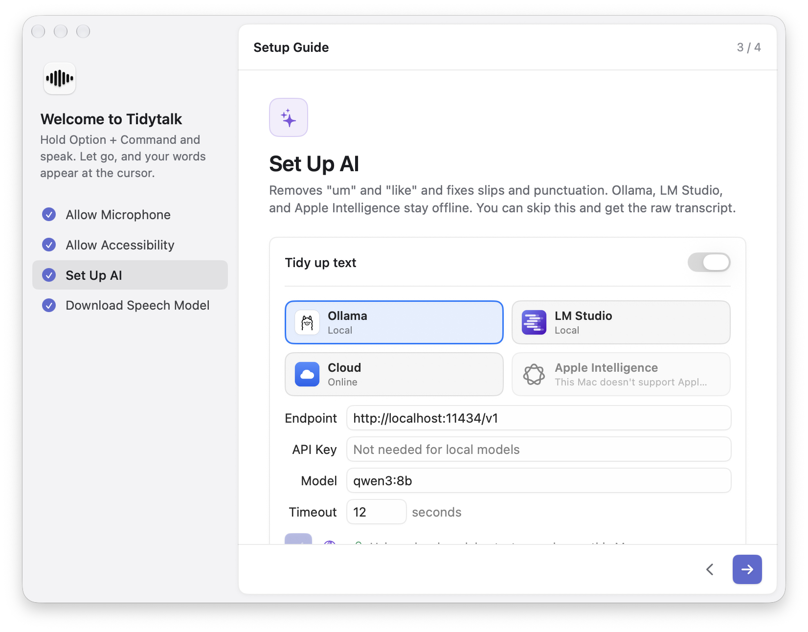

# Tidytalk

**Hold to talk. Let go, and you get clean text.** Private voice input for macOS: speech is recognized on your Mac, and with Ollama, AI tidying stays local too.

[简体中文](README.md) | English | [Website](https://tidytalk.zayen.dev/)

<p align="center">
  
</p>

Hold a shortcut and say a paragraph. When you let go, Tidytalk recognizes your speech on your Mac, uses AI to remove fillers like "um" and "you know" and fix slips and punctuation, then pastes the text at your cursor. It works anywhere you can type: chat apps, email, notes, code editors.

| You say | You get |
| --- | --- |
| Um so I wanted to ask, like, what's the uh rate limit for this API | I wanted to ask what the rate limit for this API is. |
| Let's move the launch to Wednesday, no wait, Thursday | Let's move the launch to Thursday. |

## Features

- **Your data stays on your Mac.** Speech is recognized locally with [SenseVoice](https://github.com/FunAudioLLM/SenseVoice), and recordings are never uploaded. With a local model in Ollama or LM Studio, AI tidying stays on your Mac too. It supports Chinese (with mixed-in English), English, Japanese, Korean, and Cantonese, and detects the language automatically.
- **Cleans up, keeps your words.** It removes fillers and slips and adds punctuation. It never summarizes or adds content, and text that sounds like a command is tidied, not followed.
- **Local AI or cloud, your choice.** Pick Ollama, LM Studio, or Cloud right in Settings; local models need no API key. Any OpenAI-compatible service, such as DeepSeek or OpenAI, works too, or turn tidying off and get the raw transcript.
- **Speak one language, write another.** Set an output language and the text is translated as it's tidied.
- **Leaves your clipboard alone.** After pasting, the clipboard is restored, including images and files.
- **And more:** personal vocabulary, replacements, snippets, custom rules, hands-free recording, voice rewrite of selected text, and Chinese–English spacing.

## Install

Requires macOS 26 or later on a Mac with Apple silicon.

1. Download the latest `Tidytalk-x.y.z.dmg` from [Releases](https://github.com/byteyu2436/tidytalk/releases) and drag Tidytalk into Applications.
2. The app isn't notarized by Apple yet, so macOS blocks it the first time. Open System Settings › Privacy & Security and click "Open Anyway" at the bottom, or run:

   ```bash
   xattr -dr com.apple.quarantine /Applications/Tidytalk.app
   ```

3. Follow the setup guide: allow microphone and accessibility access, set up an AI service (optional), and download the speech model (about 240 MB, one time).

You can also [build from source](docs/development.md).

## Usage

1. Put your cursor in any text field.
2. Hold **Option + Command** and speak. An indicator appears at the bottom of the screen.
3. Let go. The text appears at the cursor.

Press Esc to cancel. Double-tap the shortcut for hands-free recording, and press it again to finish. To rewrite text, select it, hold **Right Option**, and say what to change (for example, "make it more formal"). All shortcuts can be changed in Settings.

The interface is available in English and Simplified Chinese and follows your system language.

## Privacy

Recording and speech recognition always happen on your Mac, and your voice is never uploaded. Whether the recognized text leaves your Mac depends on how you set up tidying:

| Setup | Your voice | Your text |
| --- | --- | --- |
| Local model (Ollama, LM Studio) | Stays on your Mac | Stays on your Mac |
| Tidy up text turned off | Stays on your Mac | Stays on your Mac (raw transcript) |
| Cloud AI (DeepSeek, OpenAI, and others) | Stays on your Mac | Sent to the AI service you chose |

- No account and no tracking in the app. Apart from the AI service you set up, it only goes online to download the speech model once and to check for updates at launch (at most once a day), which you can turn off.
- Settings, including your API key, are stored in `~/.tidytalk.json`, readable only by you.
- Recent results are kept in memory only and cleared when you quit.
- The code is fully open source, so you can verify all of this yourself.

## Documentation

The detailed docs are currently in Chinese:

- [Usage guide](docs/usage.md): every feature, cleanup strength and modes, output language, error handling, uninstalling
- [Configuration](docs/configuration.md): all fields in `~/.tidytalk.json`
- [Development](docs/development.md): building, releasing, how it works, localization, code layout

## Acknowledgements

- [SenseVoice](https://github.com/FunAudioLLM/SenseVoice) by FunAudioLLM (Tongyi Lab): the SenseVoice-Small speech model
- [sherpa-onnx](https://github.com/k2-fsa/sherpa-onnx): runs the model on device

See [THIRD_PARTY_NOTICES.md](THIRD_PARTY_NOTICES.md) for third-party licenses.

## License

[MIT](LICENSE)
