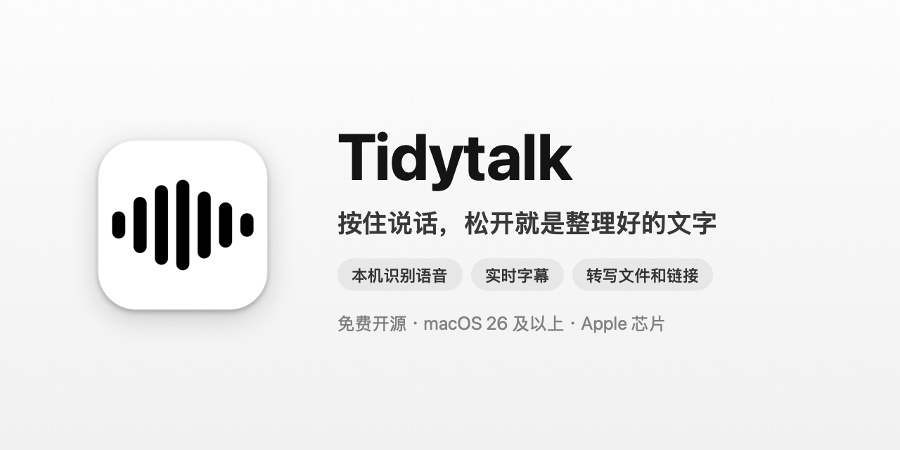
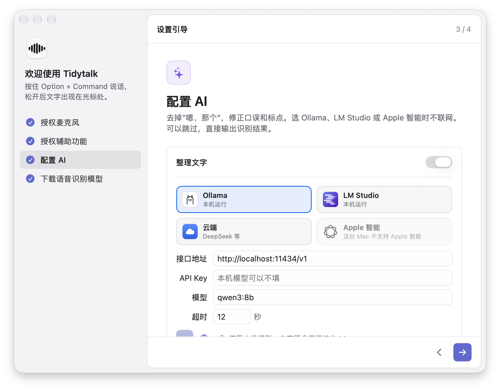

# Tidytalk

**按住说话，松开就是整理好的文字。** 一款本地运行的 macOS 语音输入工具：语音在本机识别，接上 Ollama 后整理也在本机完成。

[English](README.md) | 简体中文 | [官网](https://tidytalk.zayen.dev/zh/)

<p align="center">
  
</p>

按住快捷键说一段话，松开后 Tidytalk 在本机识别语音，用 AI 去掉"嗯、那个、就是说"这类口头禅、修正口误和标点，再把文字粘贴到光标处。在任何能打字的地方都能用：微信、邮件、备忘录、代码编辑器。

| 你说的 | 输出 |
| --- | --- |
| 嗯那个我想问一下就是这个 API 的那个 rate limit 呃是多少 | 我想问一下这个 API 的 rate limit 是多少？ |
| 项目要延期到下周三，不对，是下周四 | 项目要延期到下周四。 |

## 特点

- **数据不出这台 Mac**：语音识别用 [SenseVoice](https://github.com/FunAudioLLM/SenseVoice) 在本机完成，录音从不上传；AI 整理可以接 Ollama、LM Studio 本机模型，文字也留在本机。支持中文（可夹英文）、英文、日文、韩文和粤语，自动判断语言。
- **只整理，不改意思**：删掉口头禅和口误，补全标点，不总结、不补充。听起来像指令的话也只会被整理成文字。
- **多种识别模型**：默认 SenseVoice，也可以换成更准、能认出词库里人名和术语的 Qwen3-ASR，或 Fun-ASR-Nano、Whisper、macOS 自带的识别，都在本机运行。
- **本机模型或云端，随你选**：设置里可以直接选 Ollama、LM Studio、云端或 Apple 智能，本机模型和 Apple 智能不需要 API Key；也可以用 DeepSeek、OpenAI 等 OpenAI 兼容接口。不想用 AI，关掉整理就直接输出识别结果。
- **说中文，出英文**：可以设置输出语言，整理时顺便翻译。
- **会议记录**：按 ⌃⌥M 同时录下你的麦克风和电脑里会议的声音，会后整理出谁说了什么，对方有几个人也能分开，几个人同时说话会标出来；还可以生成 AI 总结（要点、决定和待办）。录音和文字只保存在这台 Mac 上。
- **实时字幕**：按 ⌃⌥C 收听电脑播放的声音（视频、网课、会议），在屏幕上显示字幕，也在本机识别；可以边听边翻译，按 ⌃⌥V 把刚才那段话整理后粘贴到光标处。
- **转写文件和链接**：拖入音频、视频文件，或粘贴 YouTube、B 站等链接，转成带时间的文字，导出 TXT、SRT 字幕或 Markdown。转写记录在主窗口的“转写”页和资料库里，链接下载的音频和封面图留在本机，可以回放、修改、删除。
- **不弄乱剪贴板**：粘贴后把剪贴板恢复成原来的内容，包括图片和文件。
- **更多**：个人词库（粘贴后改过的词会提示加入）、固定替换、快捷短语、自定义规则、免按住录音、语音改写选中的文字、中英文排版规范。

## 安装

需要 macOS 26 或更高版本、Apple 芯片的 Mac。

1. 在 [Releases](https://github.com/byteyu2436/tidytalk/releases) 下载最新的 `Tidytalk-x.y.z.dmg`，把 Tidytalk 拖进"应用程序"文件夹。
2. 安装包目前没有经过苹果公证，第一次打开会被系统拦下。打开"系统设置 › 隐私与安全性"，在页面底部点"仍要打开"；或者在终端执行：

   ```bash
   xattr -dr com.apple.quarantine /Applications/Tidytalk.app
   ```

3. 按引导授权麦克风和辅助功能、填写 AI 接口（可以跳过）、下载语音识别模型（约 240 MB，只需一次）。

<p align="center">
  
</p>

也可以[从源码编译](docs/development.md)。

## 使用

1. 把光标放在任意输入框里。
2. 按住 **Option + Command** 说话，屏幕底部会出现指示器。
3. 松开按键，文字出现在光标处。

按 Esc 取消。快速双击快捷键可以免按住录音，再按一次结束。选中一段文字后按住**右侧 Option** 说出修改要求（例如"改得正式一点"），可以直接改写选中的文字。快捷键都可以在设置里更换。

按 **⌃⌥C**（Control + Option + C）打开实时字幕，收听电脑播放的声音；收听时按 **⌃⌥V** 粘贴刚才那段话，或者把鼠标移到字幕条上的某一句，点它旁边的"粘贴"，从那句粘贴到最新。

详细说明见[使用指南](docs/usage.md)。

## 隐私

录音和语音识别始终在本机完成，声音不会上传，实时字幕收听的电脑声音也一样。识别出的文字是否离开电脑，取决于你怎么设置 AI 整理：

| 设置 | 声音 | 文字 |
| --- | --- | --- |
| 本机模型（Ollama、LM Studio）或 Apple 智能 | 留在本机 | 留在本机 |
| 关闭整理文字 | 留在本机 | 留在本机（直接输出识别结果） |
| 云端 AI（DeepSeek、OpenAI 等） | 留在本机 | 发送给你选的 AI 服务 |

- 不用注册账号，应用里没有统计和追踪。除了你配置的 AI 接口和你要转写的链接，只在首次下载语音模型和启动时检查更新（每天最多一次）时联网，检查更新可以关闭。
- 设置保存在 `~/.tidytalk.json`，只有你自己能读写；API Key 存在 macOS 钥匙串里。
- 会议记录的文字和录音、文件和链接的转写记录（包括链接下载的音频和封面图）只保存在这台 Mac 上，可以逐个删除。
- 说话记录默认在这台 Mac 上保存 30 天（资料库里可以搜索），可以在“设置 › 隐私与数据”里改保留多久或关掉；实时字幕只在内存里，关掉字幕或退出即清空。打开字幕翻译时，字幕文字发送给你配置的 AI 服务（选本机模型则不联网）。
- 代码完全开源，可以自己核实。

完整的隐私说明（会联网的每一种情况、本机存了什么、每项权限的用途）见官网的[隐私说明](https://tidytalk.zayen.dev/zh/privacy/)。

## 文档

- [使用指南](docs/usage.md)：所有功能、整理强度与模式、输出语言、出错时的处理、卸载
- [配置文件](docs/configuration.md)：`~/.tidytalk.json` 的全部字段
- [开发](docs/development.md)：编译、打包发布、工作原理、国际化、代码结构

## 致谢

- [SenseVoice](https://github.com/FunAudioLLM/SenseVoice)（通义实验室 FunAudioLLM）：语音识别模型 SenseVoice-Small
- [sherpa-onnx](https://github.com/k2-fsa/sherpa-onnx)：在本机运行模型

第三方组件的许可见 [THIRD_PARTY_NOTICES.md](THIRD_PARTY_NOTICES.md)。

## 支持这个项目

如果 Tidytalk 对你有用，欢迎在 GitHub 上点个 ⭐ Star，让更多人看到它。遇到问题或有想法，可以[提 Issue](https://github.com/byteyu2436/tidytalk/issues)。

## 许可证

[MIT](LICENSE)
