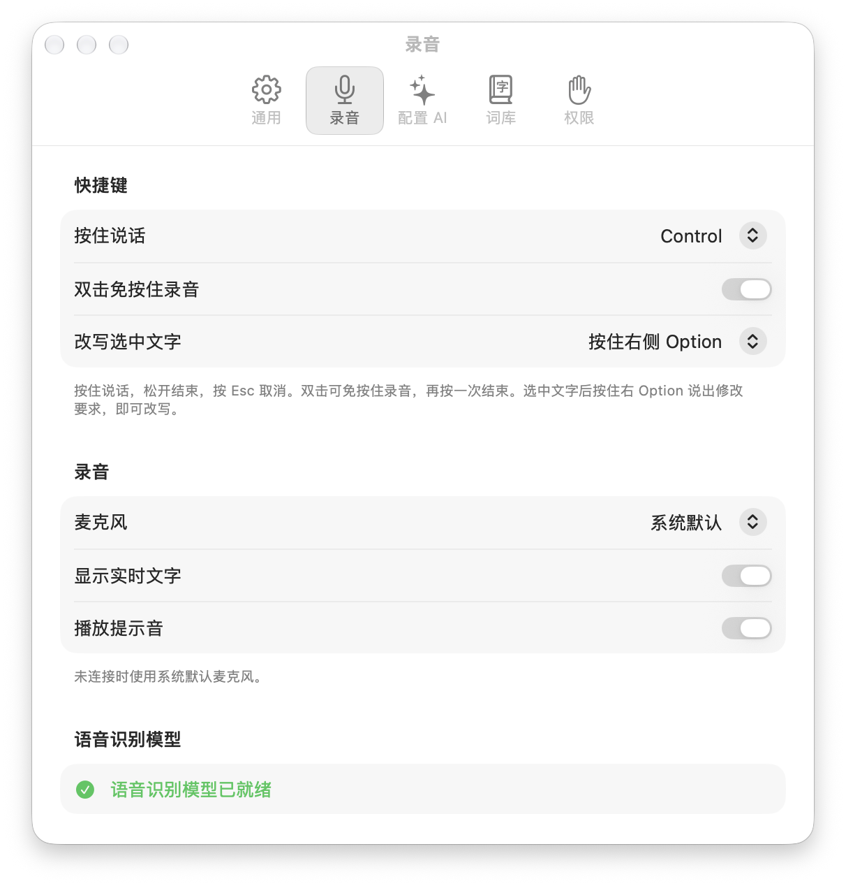
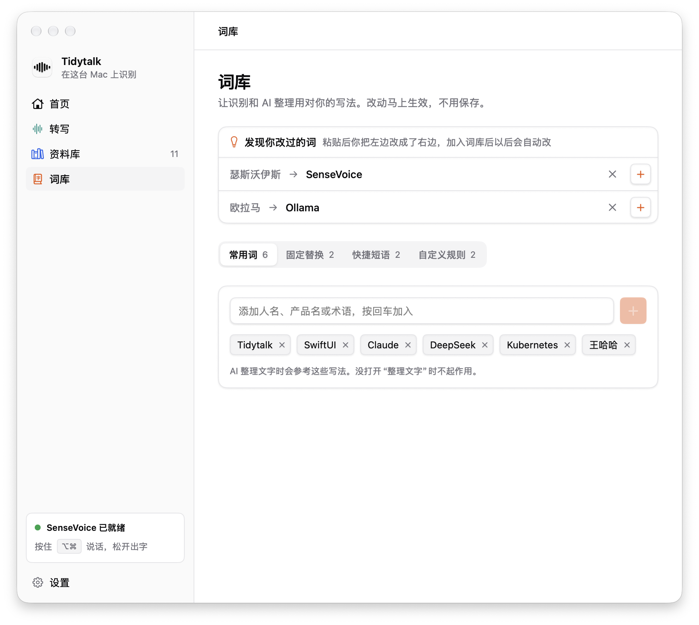

# 使用指南

## 它是什么，不是什么

Tidytalk 是**段落式**的：说完一整段，松开按键，一次性输出整理好的文字。适合写消息、写文档、记想法这类"想清楚再说"的场景。

它**不是**实时逐字输入法，不会边说边往输入框里打字，也不替代系统输入法。说话时指示器下方会显示识别到的文字，方便确认自己说了什么，但这只是预览；最终结果在松开后整段识别、整理再粘贴。

## 按住说话

1. 在任意输入框里放好光标。
2. 按住 Option + Command 说话。屏幕底部会出现一个玻璃质感的指示器，随音量跳动。
3. 说完松开，稍等片刻，文字出现在光标处。

<p align="center"></p>

细节：

- 按住超过约 0.4 秒才开始录音，日常按 Option + Command + 某个键的快捷键不会误触发。
- 按住期间按下其他键、其他修饰键、Esc，或点击鼠标，会取消本次录音。
- 已经按着 Shift、Control 或 Fn 时再按，不会触发。
- 单次录音最长约 2 分钟，不足 0.5 秒的录音会被忽略。
- 快捷键可以在"设置 › 录音 › 快捷键"里换成 Control、Option、Command、Fn（🌐）、右侧 Option 或右侧 Command。选 Fn 时，需要在"系统设置 › 键盘"里把"按下 🌐 键时"设为"无操作"，否则会同时弹出表情或听写。
- 麦克风默认跟随系统，也可以在"设置 › 录音"里指定外接耳机、会议麦克风等；指定的设备未连接时自动用系统默认麦克风。
- 开始、结束录音时有提示音，可以在设置里关闭。
- 说话时，指示器下方用灰色小字显示识别到的内容：放得下时居中，说得多了最新的文字在右边，前面的向左淡出。预览在本机完成，每 0.6 秒刷新一次，可以在设置里关闭。
- 当前没有可以输入的地方时（例如焦点在桌面、网页正文、列表上），不会模拟粘贴，而是把结果放进剪贴板并提示"已拷贝到剪贴板"。无法判断焦点的应用会照常粘贴。

### 免按住录音

快速双击快捷键，开始录音后就可以松手，适合说较长的内容；再按一次快捷键结束，按 Esc 取消。录音期间打字、点击鼠标不会打断录音。可以在设置里关闭。

### 语音改写选中的文字

先选中一段已有的文字，按住改写键（默认右侧 Option）说出修改要求，例如"改得正式一点""缩短到一句话""翻译成英文"，松开后选中的文字会被替换成改写结果。改写时指示器上显示"改写"，周围有彩色光点向外飘散。

- 需要配置 AI；选中的文字和修改要求会发送给 AI 服务。
- 优先通过辅助功能直接读取选中的文字；读不到时（例如部分网页和 Electron 应用）会模拟一次 Cmd+C，读完立即恢复剪贴板。
- 没有选中文字时提示"请先选中要改写的文字"；改写失败时原文不会改动。
- 改写键可以在设置里更换或关闭，不能和按住说话的键相同。

## 整理效果

整理只做删减和修正，不改变你说的内容：

- 删除没有实际含义的填充词，例如：嗯、呃、那个、就是说、um、uh、like。
- 删除重复的词句和口误；中途改口时，只保留改口后的说法。
- 补全标点，必要时断句。
- 不总结、不补充，保持原文的语气；句中的英文单词和术语原样保留。默认保持原文的语言，需要时可以设置[输出语言](#输出语言)。
- 即使你说的话听起来像指令（比如"帮我写一封邮件"），也只会被整理成文字，不会被执行。

| 你说的 | 输出 |
| --- | --- |
| 嗯那个我想问一下就是这个 API 的那个 rate limit 呃是多少 | 我想问一下这个 API 的 rate limit 是多少？ |
| 项目要延期到下周三，不对，是下周四 | 项目要延期到下周四。 |

在"设置 › 配置 AI"里关闭"整理文字"后，直接输出识别结果，应用完全离线工作。

### 整理强度

| 强度 | 效果 |
| --- | --- |
| 轻度 | 只补全标点、删除"嗯、呃"这类语气词，其余原话保留 |
| 标准 | 删除填充词和口误，补全标点（默认） |
| 深度 | 在标准基础上进一步精简啰嗦、重复的表达，但不改变原意 |

### 整理模式

| 模式 | 效果 |
| --- | --- |
| 标准 | 删除填充词、修正口误、补全标点，保持原意（默认） |
| 聊天（口语） | 保持口语化的语气，保留句末语气词 |
| 邮件（书面） | 使用书面表达，句子完整 |
| 代码（保留术语） | 严格保留术语、命令、文件名和符号，不转换标点 |

强度和模式在"设置 › 配置 AI › 整理方式"里切换。因为整理只做删减和修正，不同模式之间的差别主要体现在语气词、标点和个别用词上。

### 输出语言

默认"与原文相同"。选择其他语言后，说中文或英文，整理后直接输出译文，例如说中文、粘贴出英文邮件。支持 English、简体中文、繁體中文、日本語、한국어、Français、Deutsch、Español。

- 在"设置 › 配置 AI › 整理方式"里修改，也可以在菜单栏图标的"输出语言"子菜单里快速切换。
- 翻译和整理在同一次请求里完成，速度和只整理差不多。词库和整理模式同样生效，例如用"邮件（书面）"模式翻译成英文。
- 翻译依赖整理：关闭整理、网络失败或结果异常时，粘贴识别原文并给出提示。
- 说的内容即使是问题或指令，也只会被翻译，不会被回答。

### 本机大模型（完全离线）

AI 整理使用 OpenAI 兼容协议，也可以接本机运行的模型服务，文字不会离开电脑：

1. 安装 [Ollama](https://ollama.com) 并下载一个模型，例如 `ollama pull qwen2.5:7b`；或者在 LM Studio 里下载并加载一个模型，打开本地服务。
2. 在"设置 › 配置 AI"里点"预设"，选"Ollama（本机）"或"LM Studio（本机）"，确认模型名后保存。本机模型不需要 API Key，超时默认放宽到 60 秒。
3. 点"测试连接"确认可用。

效果取决于模型大小。小模型对"只整理、不回答"和自定义规则的遵守可能不如云端模型稳定，建议用 7B 左右或更大的模型。

## 词库

都在"设置 › 词库"里。

<p align="center"></p>

### 常用词

每行一个人名、产品名或专业术语，这些词最容易识别错。SenseVoice 本身不支持热词，所以常用词会放进 AI 整理的提示里，让模型把读音相近的错误识别改成正确写法，例如"森斯沃伊斯"改为"SenseVoice"。读音不像或拿不准的地方保持原文。需要开启整理文字。

### 固定替换

识别结果里出现某个词时总是替换成指定写法，例如"克劳德"总是替换成"Claude"。英文不区分大小写、只匹配完整单词。在本机处理，关闭整理时也生效。

在菜单栏图标的"最近记录"里选一条，点"加入词库…"，可以直接把识别错的词加进替换表和常用词。

### 快捷短语

例如"我的邮箱" → 完整的邮箱地址。整句话只说这个短语时，直接输出设置好的内容，不经过 AI；句子中间提到这个短语不会被替换。

### 自定义规则

每行写一条自己的写法要求，例如"金额一律用阿拉伯数字""称呼对方统一用'您'""产品名写作 Tidytalk"。AI 整理和语音改写时都会遵守；规则只影响写法，不会让 AI 补充原文没有的内容。最多 20 条，需要开启整理文字。

## 中英文排版规范

在本机自动处理，不需要联网：中文与英文、数字之间加空格；中文后面的标点统一为全角；全角字母和数字转为半角；全角标点两侧不留空格。数字里的小数点、文件名、网址等不受影响。可以在"设置 › 通用"里关闭。

## 最近记录

最近 20 次的结果记在内存里，可以在菜单栏图标的"最近记录"里：

- 重新粘贴或拷贝，适合误粘贴或想再用一次的时候；
- 拷贝未经整理的识别原文；
- "重新整理"：换成其他整理模式或翻译成其他语言，结果直接粘贴到当前输入框，不用再说一遍（需要配置 AI）；
- "加入词库…"：把识别错的词加进替换表和常用词。

记录不写入磁盘，退出应用即清空；也可以在设置里关闭或随时清空。

## 开机自动启动

在"设置 › 通用"里打开，使用系统的登录项。系统要求确认时，按提示到"系统设置 › 通用 › 登录项"里允许。

## 支持的语言

说话时不需要选择语言，识别会自动判断：

- 中文普通话，包括句中夹杂英文单词和技术术语（如 demo、API、SDK）
- 英文
- 日文
- 韩文
- 粤语（识别结果用简体字，保留粤语的说法，例如"听日""带埋"）

不支持其他语言（例如法语、德语、西班牙语）和其他方言。需要输出其他语言时，可以用中文或英文说，再通过"输出语言"翻译。

界面支持简体中文和英文，跟随系统语言：系统首选语言是中文时显示中文，其他语言显示英文。AI 整理的提示词固定为中文，对说英文、日文等的内容同样有效。

## 出错时会怎样

| 情况 | 处理 |
| --- | --- |
| 网络不可用、AI 服务超时或报错 | 直接粘贴识别原文，并提示"整理失败，已粘贴原文" |
| 整理结果明显异常（比原文长很多或短很多） | 视为整理失败，粘贴识别原文 |
| 没有识别到内容 | 提示"没有听到内容"，不粘贴 |
| 缺少权限 | 提示需要授权的项目 |

### 辅助功能显示未授权

系统设置里已经打开了 Tidytalk 的开关，应用却仍显示未授权，通常是列表里留着旧版本的条目。在"系统设置 › 隐私与安全性 › 辅助功能"里选中 Tidytalk 点"−"删除，再回到 Tidytalk 点"授权"重新添加；或者在终端执行：

```bash
tccutil reset Accessibility app.tidytalk.Tidytalk
```

## 卸载

把 Tidytalk 拖进废纸篓只会删除应用本身，语音识别模型、配置文件和授权记录都会留在电脑上，需要手动清理：

1. 如果开启了开机自动启动，先在"设置 › 通用"里关掉，然后在菜单栏图标里选"退出 Tidytalk"。
2. 把"应用程序"文件夹里的 Tidytalk 拖进废纸篓。
3. 在终端里执行：

   ```bash
   rm -rf ~/Library/Application\ Support/Tidytalk
   rm -f ~/.tidytalk.json
   rm -rf ~/Library/Caches/app.tidytalk.Tidytalk ~/Library/HTTPStorages/app.tidytalk.Tidytalk
   defaults delete app.tidytalk.Tidytalk
   tccutil reset All app.tidytalk.Tidytalk
   ```

| 位置 | 内容 |
| --- | --- |
| `~/Library/Application Support/Tidytalk/` | 语音识别模型，约 240 MB |
| `~/.tidytalk.json` | 设置、AI 接口地址和 API Key、词库、快捷短语、自定义规则 |
| `~/Library/Caches/app.tidytalk.Tidytalk/`、`~/Library/HTTPStorages/app.tidytalk.Tidytalk/` | 系统为联网请求留下的缓存 |
| `~/Library/Preferences/app.tidytalk.Tidytalk.plist` | 系统保存的窗口位置等偏好，用 `defaults delete` 删除 |
| 系统设置里的麦克风、辅助功能授权 | 用 `tccutil reset` 清除，也可以在"系统设置 › 隐私与安全性"里选中 Tidytalk 点"−"移除 |

打算以后重装、想保留设置和词库的话，可以不删 `~/.tidytalk.json`。这个文件里有 API Key，电脑给别人用之前建议删掉；它是隐藏文件，在访达里按 Command + Shift + 句号可以显示。
